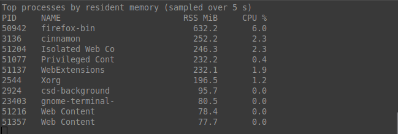

# linux_memory_controller
A simple linux memory usage controller. 

## Overview
Sometimes I find it a hassle to manage software using htop or top because there's so much to read. That's why I created this software.

## Usage
git clone https://github.com/eeemo-hoge/linux_memory_controller/

cd linux_memory_controller/src/v.x.x/

g++ main.cpp

./a.out

## Features
- Simple
- Show pid and RAM, CPU usage in decreasing order.

## Vision
To enable the display of more software while maintaining this prototype.

## Images

license is "[LICENSE](LICENSE)"
